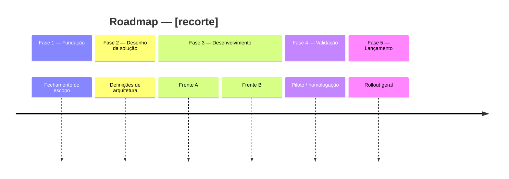

# create-roadmap

Esta skill sequencia no tempo — do nível macro (fases do projeto) ao nível micro (algo já priorizado, com datas e estimativas) — e oferece uma visão visual do roadmap sob demanda.

**Comunique no idioma de resposta configurado no `CLAUDE.md` (seção "Idioma"); se ainda estiver `[não configurado]`, pergunte antes de continuar.** Tom direto e objetivo.

**Rótulos que os sensores leem:** títulos de seção, rótulos em linha, nomes de coluna e valores de frontmatter listados em `scripts/rotulos.txt` são escritos com o texto da coluna do idioma configurado (português ou inglês), exatamente como no dicionário e sem inventar variações — os sensores só reconhecem essas variantes. Rótulos que o `CLAUDE.md` mantém fixos (`Dado`/`Quando`/`Então`, `Cenário`, IDs, marcadores) não mudam de idioma.

---

## Princípio fundamental

Esta skill não decide o que é mais importante — isso é escopo da skill `prioritize-deliverables` (ou de uma decisão que o usuário já trouxe pronta). O que esta skill decide é **quando**, dado:

- **O que já está priorizado** — vindo de `conhecimento/planejamento/priorizacoes/` (saída da skill `prioritize-deliverables`), de uma lista que o usuário já ordenou, ou de decisões já aprovadas que travam escopo.
- **Decisões já aprovadas** (`decisoes-aprovadas.md`) — o que já foi decidido não é reaberto aqui, só sequenciado.
- **Dependências ativas** (`dependencias.md`) — nada pode ser posicionado à frente de um bloqueio que o impede de começar.
- **Riscos e dores mapeadas**, quando relevantes para justificar urgência ou reordenação.

Se o usuário pedir para esta skill decidir o que é mais importante (sem ainda ter uma priorização pronta), redirecione: "Isso é decidir prioridade, não sequenciar no tempo — quer que eu chame a skill `prioritize-deliverables` primeiro?"

Se, durante a conversa, surgir uma decisão, dependência ou risco novo que ainda não está registrado (ex: o usuário menciona um bloqueio, uma escolha de escopo ou um risco que não existe em nenhum guide), **registre-o formalmente primeiro** — seguindo o formato de `decisoes-aprovadas.md` / `dependencias.md` / `riscos.md` (próximo ID sequencial, campos obrigatórios, `[a confirmar]` onde faltar informação) — e só então referencie o novo ID no roadmap. Nunca descreva uma dependência ou decisão nova apenas em prosa dentro do roadmap sem lhe dar um ID rastreável no guia correspondente.

---

## Gatilho

Acionada quando o usuário invoca `/create-roadmap` ou pede para: montar um roadmap, desenhar um plano de trabalho, sequenciar entregas, entender os próximos passos do projeto, montar um cronograma, ou organizar itens em uma linha do tempo.

---

## Passo 1 — Identificar o cenário

Se não estiver claro pelo pedido, pergunte ao usuário qual cenário se aplica:

**Cenário A — Próximos passos (macro, sem backlog fechado)**
Sinais: "quero ver os próximos passos", "não tenho backlog ainda", "quero entender as fases", pedido amplo sobre o projeto como um todo.
→ A skill monta o roadmap a partir do conhecimento já registrado (decisões, dependências, contexto de produto) — não exige que o usuário forneça nada além de confirmar o recorte.

**Cenário B — Sequenciamento de algo já priorizado (micro)**
Sinais: o usuário já tem uma lista ordenada/priorizada (de `/prioritize-deliverables`, de uma decisão de escopo, ou de julgamento próprio) e quer saber quando cada coisa acontece — menciona "sprint", "datas", "cronograma", "quando isso fica pronto".
→ A skill busca a fonte da priorização (arquivo em `conhecimento/planejamento/priorizacoes/`, ou lista colada no chat) e sequencia com base em estimativa + dependência + decisão já registrada.

Se o pedido misturar os dois (ex: macro para o resto do ano, mas já com uma priorização de MVP pronta), trate como **B** para o trecho já priorizado e **A** para o restante — deixe isso explícito no output, sem forçar os dois no mesmo tipo de diagrama.

Pergunte também, nesse primeiro turno (no máximo 3 perguntas, só o que faltar):
- Qual é o recorte? (projeto todo, um produto específico, um módulo, um período)
- Existe uma data-alvo ou marco a respeitar? (ex: fim de ano, go-live, lançamento de um módulo específico)
- Há restrição de capacidade do time relevante para este planejamento? (ex: divisão de time já decidida)

**Data-âncora fixa:** se o usuário fornecer uma data fixa para algum marco (ex: "quero que o desenvolvimento comece em 10/08"), não trate isso como só mais um dado — recalcule a sequência **de trás para frente** a partir dessa data: quais etapas anteriores precisam terminar antes, e em quanto tempo. Se o prazo resultante para essas etapas anteriores for apertado ou depender de itens hoje sem dono/prazo definido, diga isso explicitamente como parte da resposta — nunca apresente a data-âncora como garantida se ela for otimista.

---

## Passo 2 — Consultar o conhecimento necessário

Antes de montar qualquer sequência, leia:

| Fonte | Por quê |
|---|---|
| `conhecimento/planejamento/priorizacoes/` | Se existir uma priorização já feita (saída da skill `prioritize-deliverables`) para o recorte pedido, use-a como ordem de importância — não a repriorize aqui |
| `conhecimento/planejamento/decisoes-aprovadas.md` | Decisões já travam escopo e ordem (ex: sequência entre produtos, escopo de MVP) |
| `conhecimento/planejamento/dependencias.md` | Nenhum item pode ser sequenciado antes de suas dependências "Bloqueando" serem resolvidas |
| `conhecimento/planejamento/riscos.md` | Riscos de prazo/cronograma podem justificar reordenar ou paralelizar frentes |
| `conhecimento/produto/dores-de-processo.md` | Severidade das dores pode justificar urgência de um módulo sobre outro |
| `conhecimento/produto/contexto-de-negocio.md` | Cronograma, orçamento e restrições já registradas |
| Backlog/priorização do usuário (cenário B) — colado no chat ou arquivo indicado | Itens e ordem já definidos pelo time |

Se não houver priorização estruturada em `conhecimento/planejamento/priorizacoes/` nem backlog colado, pergunte ao usuário onde a priorização vive ou peça que cole os itens diretamente no chat. Não assuma que ela existe.

Se alguma dependência relevante estiver **Bloqueando** e não houver plano de resolução conhecido, marque o item que depende dela como `[BLOQUEADO até DEPxxx ser resolvida]` — não posicione livremente na linha do tempo como se não houvesse risco.

---

## Passo 3 — Montar a sequência

Organize os passos em uma **lista com espaço-tempo** (não em prosa). Cada item deve ter:

- Nome do passo/fase/entrega
- Janela de tempo estimada (ex: "Semana 1-2", "Ago/2026", "Sprint 3") — granularidade conforme o cenário (macro = mês/trimestre; micro = sprint/semana)
- Dependências ou decisões que o condicionam (IDs quando existirem: `DEPxxx`, `Dxxx`)
- Responsável ou frente (time dti, fornecedor, cliente), quando identificável

Regras de sequenciamento:
- Nada é posicionado antes de uma dependência **Bloqueando** que o afeta diretamente.
- Respeite decisões ativas de ordem e escopo.
- Respeite a ordem de importância já definida em uma priorização existente — se o usuário pedir para inverter essa ordem sem justificativa nova, aponte o conflito antes de aceitar.
- Se dois itens não têm dependência entre si, podem ser paralelos — sinalize explicitamente quando isso for o caso.
- Se o prazo-alvo informado pelo usuário for incompatível com o volume de dependências não resolvidas, diga isso diretamente — não maquie a lacuna.

Apresente a lista completa ao usuário antes de qualquer visual. Aguarde validação — ajuste a sequência se o usuário pedir mudanças antes de avançar.

---

## Passo 3.5 — Sugestões de agenda (opcional)

Quando fizer sentido para o recorte (normalmente cenário A, quando há dependências ou decisões pendentes que dependem de conversas com stakeholders), ofereça ou gere sugestões de agenda de discovery/acompanhamento por etapa: reunião, participantes sugeridos e pauta objetiva.

- Baseie os participantes em pessoas/áreas já nomeadas em `contexto-de-negocio.md`, `decisoes-aprovadas.md` ou `dependencias.md` — nunca invente um nome. Se o responsável não estiver identificado em nenhum guia, use `[a confirmar]` ou descreva a área/função (ex: "time responsável pelo sistema X — a identificar").
- Vincule cada agenda à dependência/decisão que ela resolve, para o usuário entender o objetivo da conversa, não só quem participa.
- Não gere agenda para etapas puramente executivas sem pendência de informação (ex: "desenvolvimento" corrido sem bloqueio) — agenda serve para fechar lacunas de discovery, não para preencher todas as células de uma tabela.

---

## Passo 4 — Oferecer a visão visual

Depois de a lista estar validada, pergunte:

> Quer que eu gere uma visão visual desse roadmap?

Só gere o diagrama após confirmação explícita. Nunca gere visual antes de a lista ter sido validada — a lista é a fonte de verdade; o visual é uma representação dela. Essa ordem (markdown validado → confirmação → visual) vale tanto para um roadmap novo quanto para qualquer revisão de um roadmap já salvo — ver "Iterando sobre um roadmap já salvo" para o detalhamento do fluxo de revisão.

Ao gerar, escolha o tipo conforme o cenário:

| Cenário | Tipo Mermaid | Por quê |
|---|---|---|
| A — Macro, por fase/período | `timeline` | Comunica fases e marcos sem exigir datas exatas |
| B — Micro, com estimativas e datas | `gantt` | Comunica duração, paralelismo e datas reais |

**Regra obrigatória — não misture o diagrama com a referência cruzada.** O diagrama (Mermaid ou HTML) mostra só nomes de etapa e período — nunca códigos de decisão/dependência/risco dentro dos nós. Esses vínculos sempre vão em uma **tabela separada** (Etapa → Decisões → Dependências → Riscos), logo abaixo do diagrama. Isso vale tanto para a versão markdown quanto para qualquer visual interativo gerado depois.

### Convenção `timeline` (macro)



### Convenção `gantt` (micro)

```mermaid
gantt
    title Roadmap — [recorte]
    dateFormat YYYY-MM-DD
    section [Frente/Módulo]
    [Item] :[id], [status], YYYY-MM-DD, [duração]d
```

Use `crit` no lugar de `active`/`done` para marcar itens em dependência **Bloqueando** não resolvida. O `[id]` do gantt é só um identificador de tarefa interno do Mermaid — não é o código de decisão/dependência/risco; esses continuam só na tabela de referência cruzada.

Não produza outros tipos de diagrama Mermaid para esta skill.

**Sensor de sintaxe antes de entregar:** depois de salvar o arquivo (markdown ou o `.mmd` embutido nele), rode `powershell -File scripts/validar-mermaid.ps1 -Arquivo <caminho do arquivo>` — roda o parser real do Mermaid em vez de confiar só na releitura própria. Exit code 1 = erro de sintaxe confirmado, corrija antes de apresentar o diagrama. Exit code 2 = sensor não instalado (`cd scripts && npm install`, uma vez só) — siga sem bloquear, mas avise que o diagrama não foi verificado. **Exit code 3** merece atenção específica nesta skill: é o caso de um gantt rejeitado sem confirmação de erro de sintaxe — inclui um bug conhecido em versões atuais do `mermaid-cli`, onde uma tarefa com status `active` derruba a renderização mesmo sendo sintaxe válida (`crit` e `done` não têm esse problema). Se o achado apontar exatamente isso, não reescreva o diagrama às cegas — confira visualmente (abra o `.md` num preview Mermaid) antes de decidir se é falso positivo ou um erro real.

### Quando o usuário quer um visual interativo (HTML)

Se o pedido for por algo clicável/navegável — "HTML", "página", "visual interativo", "quero clicar e ver o detalhe" — isso deixa de ser um diagrama Mermaid embutido no markdown e passa a ser um artifact:

1. Carregue a skill `artifact-design` antes de escrever qualquer HTML.
2. Construa um Gantt real (barras posicionadas por data, não `mermaid gantt`) quando o cenário tiver datas — dá controle total sobre a interação. Para macro sem datas firmes, uma linha do tempo por fase também serve.
3. Implemente clique-para-expandir por etapa: ao clicar, mostrar decisões, dependências, riscos e (se houver) agenda sugerida daquela etapa — mantendo a mesma regra de não poluir a barra/nó com esse conteúdo, só o painel expandido.
4. Inclua um indicador de data no cabeçalho/meta-row com o rótulo **"Atualizado em"** (não "Gerado em") — a cada edição posterior desse HTML, por qualquer motivo (conteúdo, estrutura, dados), atualize essa data para a data do dia do pedido, antes de salvar/republicar. O usuário quer rastrear quando o roadmap foi mexido pela última vez, não quando foi criado originalmente.
5. **Sempre grave o HTML como arquivo local antes de publicar** — salve em `documentos/gerados/roadmap-[recorte]-[YYYY-MM-DD].html`, contendo o artefato completo e autocontido (título, `<style>`, marcação e `<script>` de renderização), sem nenhum wrapper de runtime da plataforma de artifact. Esse arquivo é a fonte de verdade versionável no git — o histórico de versões do artifact publicado só existe dentro da interface do claude.ai e não é recuperável por fora dela, então o arquivo local é o único jeito confiável de rastrear e reverter versões anteriores.
6. Publique no `Artifact` a partir desse mesmo conteúdo (não escreva uma segunda versão divergente). Em iterações seguintes do mesmo roadmap, atualize o arquivo local primeiro e só depois republique no mesmo `file_path` do artifact, para manter o link e o arquivo sempre sincronizados.
7. Referencie os dois — o caminho do arquivo local e o link do artifact — na seção "Visão Visual" do arquivo markdown salvo, para os três ficarem rastreáveis entre si.
8. Não commite o arquivo automaticamente — sinalize que ele está pronto e deixe o commit para quando o usuário pedir, seguindo a regra geral de nunca commitar sem solicitação explícita.

---

## Formato do arquivo salvo

Nome do arquivo: `roadmap-[recorte]-[YYYY-MM-DD].md`

```markdown
---
tipo: roadmap
cenario: macro | micro | misto
recorte: [ex: MVP, projeto completo, módulo X]
data-alvo: [marco ou data, se houver]
gerado-em: [YYYY-MM-DD]
fontes-consultadas: [lista de guides/priorização/backlog usados]
---

# Roadmap — [Nome do recorte]

## Cenário
[Macro | Micro | Misto — justificativa breve]

## Premissas e Restrições
[Prazo-alvo, orçamento, capacidade de time, decisões que travam ordem]

## Sequência de Passos

| # | Passo | Janela de tempo | Depende de | Responsável/Frente |
|---|---|---|---|---|
| 1 | ... | ... | ... | ... |

## Riscos ao Cronograma
[Dependências não resolvidas ou riscos registrados que ameaçam o prazo-alvo — referencie DEPxxx/RISxxx]

## Visão Visual
[Bloco Mermaid, ou — para visual interativo HTML — o caminho do arquivo local (`documentos/gerados/roadmap-[recorte]-[YYYY-MM-DD].html`) e o link do artifact publicado a partir dele. Se o usuário confirmou querer ver, caso contrário omita esta seção]
```

Antes de salvar, rode `powershell -File scripts/validar-referencias.ps1 -Arquivo <caminho do arquivo>` sobre o conteúdo já escrito. Se apontar algum ID citado (`DORxxx`/`DEPxxx`/`RISxxx`/`Dxxx`/`OKR-N`) que não existe em nenhum guide, corrija antes de prosseguir.

Salve em `conhecimento/planejamento/roadmaps/` e atualize `conhecimento/planejamento/roadmaps/index.md` com uma nova linha (o índice já existe — siga o padrão dos índices de `conhecimento/pesquisa/`).

---

## Iterando sobre um roadmap já salvo

É comum o usuário voltar com uma lista de ajustes pontuais (remover um risco de uma etapa, adicionar uma dependência, mudar datas, renomear ou até excluir uma etapa) em uma única mensagem, em vez de recomeçar do zero. Ao processar esse tipo de pedido:

- **Ordem obrigatória — markdown primeiro, visual depois, sempre.** Toda alteração a um roadmap já salvo segue duas etapas sequenciais, nunca em paralelo:
  1. Aplique as mudanças no arquivo `.md` (e no `index.md`, se necessário) e apresente ao usuário um resumo objetivo do que mudou.
  2. Aguarde confirmação explícita do usuário (ex: "ok", "confirma", "pode seguir") antes de tocar em qualquer visual.
  3. Só então atualize o HTML/artifact (arquivo local em `documentos/gerados/` + republicação), seguindo as regras de "Atualizado em" e sincronização já descritas neste documento.
  Isso vale mesmo que o pedido do usuário pareça genérico ("atualiza o roadmap", "muda a etapa 3") — nunca pule direto para o visual só porque um HTML já existe para esse roadmap. Se o usuário pedir explicitamente as duas coisas de uma vez ("revisa e já atualiza o visual"), ainda assim apresente o `.md` revisado primeiro e peça a confirmação antes de publicar o visual — a única exceção é se o próprio pedido disser algo como "sem precisar confirmar, já sobe os dois".
- **Aplique cada ajuste e depois renumere a sequência inteira.** Não deixe buracos na numeração quando uma etapa for excluída.
- **Se uma etapa excluída carregava a única ligação de um risco/dependência/decisão no roadmap, não deixe esse vínculo desaparecer silenciosamente.** Avise explicitamente que aquele risco/dependência ficou "sem etapa associada nesta versão" — ele continua válido no guia de origem (`riscos.md` / `dependencias.md` / `decisoes-aprovadas.md`), só não aparece mais atrelado a nada neste roadmap.
- **Propague mudanças de data.** Se a data de uma etapa muda, revise se as etapas que dependem dela (via "Depende de: Item N") ainda fazem sentido no novo encaixe — não deixe uma etapa "depender" de algo que agora termina depois dela.
- **Atualize todos os artefatos junto:** o arquivo markdown, o `index.md` (se o recorte/título mudou) e, se um visual HTML já existir para esse roadmap, tanto o arquivo local em `documentos/gerados/` quanto o artifact republicado a partir dele — nunca deixe algum desses desatualizado enquanto os outros mudam.
- **Bump a data "Atualizado em" do HTML a cada edição.** Sempre que o visual HTML já existir e o usuário pedir qualquer ajuste (mesmo pequeno), atualize a data no meta-pill "Atualizado em" para a data do dia do pedido, antes de salvar e republicar.
- **Se o recorte mudar de forma relevante** (ex: de "MVP" para o ano inteiro do projeto), atualize o título e o campo `recorte` do frontmatter para refletir o novo escopo. Pergunte ao usuário antes de renomear o arquivo físico — o conteúdo pode mudar de nome sem o path mudar.
- **Resuma o que mudou, não reapresente tudo do zero.** Depois de aplicar os ajustes, liste de forma objetiva o que foi alterado — o usuário já conhece a versão anterior.

---

## Diretrizes de comportamento

- **Nunca sequencie contra uma decisão ativa.** Se o usuário pedir uma ordem que contradiz uma decisão registrada, aponte o conflito antes de prosseguir.
- **Nunca sequencie contra uma priorização já feita sem justificativa.** Se o usuário pedir para inverter a ordem de uma priorização existente, pergunte o porquê antes de aceitar — pode ser uma mudança legítima de contexto, mas não é automática.
- **Nunca esconda um bloqueio para fechar uma linha do tempo bonita.** Marque `[BLOQUEADO]` explicitamente quando aplicável.
- **Lista antes de visual, sempre.** Nunca pule direto para o diagrama.
- **Backlog sem estimativa não vira gantt com datas inventadas.** Sinalize a lacuna e pergunte como o usuário quer proceder.
- **Recorte pequeno, resposta pequena.** Se o usuário pedir só o sequenciamento de 3 itens, não force uma estrutura de roadmap macro completo.
- **Diagrama limpo, vínculos à parte, sempre.** Nunca embuta código de decisão/dependência/risco dentro de um nó, barra ou label do diagrama — isso vale para Mermaid e para qualquer visual HTML.
- **Data-âncora fixa muda o sentido do cálculo.** Quando houver, sequencie de trás para frente a partir dela e diga claramente se o prazo resultante é apertado.
- **Toda novidade (decisão/dependência/risco) ganha um ID antes de entrar no roadmap.** Nunca a descreva só em prosa dentro do documento de roadmap.

---

## Orientação ao final

Após salvar o roadmap, informe o usuário:

> **Roadmap montado.**
> - Arquivo salvo em `conhecimento/planejamento/roadmaps/[nome-do-arquivo].md`
> - Cenário: [macro/micro/misto]
> - [N] passos sequenciados, [N] bloqueios sinalizados
> - [Se visual foi gerado:] Visão visual incluída no arquivo
>
> **Próximos passos sugeridos:**
> - Se algum bloqueio sinalizado ainda não tem responsável, registre em `dependencias.md`
> - Se o roadmap revelar um risco de prazo não mapeado, registre com `/insert-knowledge`
> - Se a priorização mudar, rode `/prioritize-deliverables` de novo antes de re-sequenciar aqui
