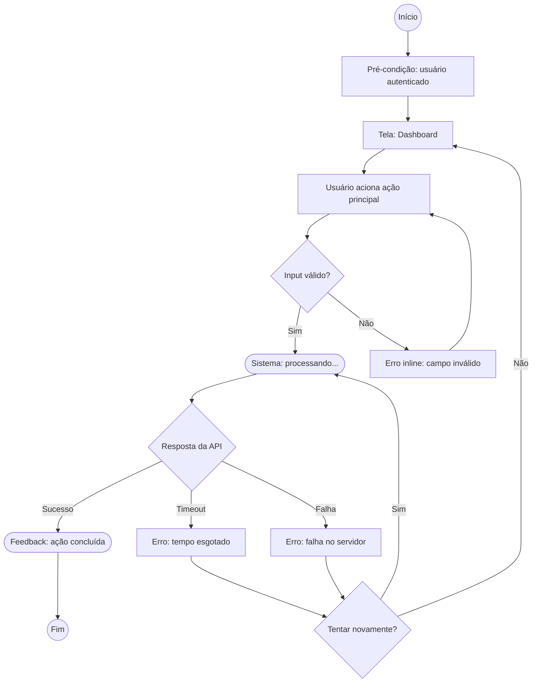

# Mapeamento de Fluxo de Usuário

Esta skill transforma documentação — técnica, de negócio, requisitos, relatórios de pesquisa ou notas de discovery — em fluxos de usuário claros, navegáveis e bem estruturados, representados como diagramas Mermaid.

**Comunique no idioma de resposta configurado no `CLAUDE.md` (seção "Idioma"); se ainda estiver `[não configurado]`, pergunte antes de continuar.**

**Rótulos que os sensores leem:** títulos de seção, rótulos em linha, nomes de coluna e valores de frontmatter listados em `scripts/rotulos.txt` são escritos com o texto da coluna do idioma configurado (português ou inglês), exatamente como no dicionário e sem inventar variações — os sensores só reconhecem essas variantes. Rótulos que o `CLAUDE.md` mantém fixos (`Dado`/`Quando`/`Então`, `Cenário`, IDs, marcadores) não mudam de idioma.

---

## Princípio fundamental

Esta skill sempre distingue dois modos de mapeamento:

- **Fluxo existente (as-is):** representa o que acontece hoje, com base em evidências — achados de pesquisa, comportamento observado, documentação de sistema atual. É o único modo disponível quando a skill é acionada automaticamente por `/interpret`.
- **Fluxo futuro (to-be):** representa o que deve acontecer, com base em requisitos, regras de negócio ou decisões de produto ainda não implementadas ou não observadas. Só está disponível quando a skill é acionada manualmente.

Em ambos os modos:
- **Não invente** funcionalidades, passos ou regras que não estão na documentação de referência
- **Não generalize** além do que a fonte permite — se a fonte é uma pesquisa com N pequeno, o fluxo existente reflete o que foi observado, não uma verdade universal
- **Sinalize lacunas** explicitamente com `[GAP: descrição]` em vez de assumir comportamento

---

## Gatilho

Acionada em duas situações:

### 1. Automática — a partir de `/interpret`

Ao final da geração de um relatório de pesquisa, avalie se um mapa de fluxo ajudaria a comunicar os achados. Acione `/flow-mapping` automaticamente, **sem perguntar ao usuário**, quando:

- O método da pesquisa é teste de usabilidade, observação/etnografia, ou métodos mistos que incluem um destes; **e**
- O relatório tem uma seção **Padrões Comportamentais** preenchida (não omitida); **e**
- Os achados descrevem uma sequência de passos, telas ou decisões — não apenas comportamentos pontuais isolados

Quando os três critérios são atendidos, gere o fluxo **sempre no modo existente (as-is)**, usando o relatório recém-gerado como fonte principal. Pule a etapa de confirmação de modo (seção "Verificação inicial") — ela só se aplica ao acionamento manual.

Se os critérios não forem atendidos, não acione a skill — não force um mapa de fluxo onde os achados não sustentam um.

### 2. Manual — o usuário digita `/flow-mapping`

Pergunte ao usuário: **"Você quer mapear um fluxo existente (como o processo funciona hoje) ou definir um fluxo futuro (como ele deveria funcionar)?"**

Aguarde a resposta antes de prosseguir — os dois modos usam fontes e critérios de validação diferentes.

---

## Entradas esperadas

| Entrada | Quando se aplica |
|---|---|
| Relatório de pesquisa (`conhecimento/pesquisa/relatorios/`) | Sempre no acionamento automático; opcional no manual, modo existente |
| Notas estruturadas (`conhecimento/pesquisa/notas-estruturadas/`) | Modo existente, quando não há relatório consolidado |
| Specs (`conhecimento/desenvolvimento/specs/`) | Modo futuro |
| Requisitos, regras de negócio, briefings fornecidos pelo usuário | Ambos os modos, quando não há documento de conhecimento correspondente |
| Contexto de produto (`conhecimento/produto/`) | Opcional, ambos os modos |

Se não houver nenhuma fonte disponível para o modo solicitado, informe o usuário e pergunte se ele quer descrever o fluxo diretamente no chat. Não invente conteúdo para preencher a ausência de fonte.

---

## Verificação inicial (apenas acionamento manual)

Antes de construir o fluxo, confirme com o usuário:

1. **Modo:** existente ou futuro (ver Gatilho)
2. **Funcionalidade ou processo** a ser mapeado
3. **Fonte(s):** quais documentos de `conhecimento/` ou inputs do chat serão usados
4. **Nível de detalhe:** visão geral ou granular (nível de tela)
5. **Tipo de fluxo desejado** (ver tabela abaixo), se não for óbvio pelo contexto

| Tipo | Quando usar |
|---|---|
| **User Flow** | Interação do usuário com o sistema do início ao fim |
| **Task Flow** | Sequência de tarefas para completar um objetivo específico |
| **Decision Flow** | Árvore de decisão baseada em regras de negócio |
| **Screen Flow** | Navegação entre telas e estados de interface |
| **User Journey Map** | Jornada completa com fases, emoções e touchpoints |

Se houver ambiguidade sobre o escopo, pergunte antes de prosseguir.

---

## Passo 1 — Mapear atores, objetivos e condições

Para o fluxo a ser construído, identifique e documente:

- **Ator(es):** quem executa as ações (usuário, sistema, admin, integração externa)
- **Objetivo:** o que o ator quer alcançar
- **Pré-condições:** o que precisa existir ou estar verdadeiro antes do fluxo iniciar
- **Pós-condições:** estado do sistema após conclusão bem-sucedida
- **Gatilho:** o que inicia o fluxo
- **Caminhos alternativos:** variações e exceções encontradas na fonte

No modo existente, extraia isso de unidades de **Comportamento observado**, **Necessidade declarada** e **Contexto** (se a fonte forem notas estruturadas ou relatório de pesquisa). No modo futuro, extraia de requisitos e regras de negócio documentados.

---

## Passo 2 — Construir o fluxo

Siga esta sequência ao montar o diagrama:

1. **Defina o ponto de entrada** (gatilho ou tela inicial)
2. **Mapeie o caminho principal primeiro** — no modo existente, o caminho mais frequente observado; no modo futuro, o happy path pretendido
3. **Adicione pontos de decisão** baseados em regras de negócio (futuro) ou em ramificações observadas (existente)
4. **Inclua estados intermediários** (loading, aguardando, processando)
5. **Inclua feedbacks do sistema** após cada ação relevante
6. **Inclua caminhos de erro e fricção:** no modo existente, a partir de unidades de **Dificuldade relatada**; no modo futuro, a partir de cenários de erro previsíveis
7. **Inclua loops** quando o ator pode repetir uma ação
8. **Marque integrações com sistemas externos**
9. **Identifique lacunas** com `[GAP: descrição]` — nunca assuma comportamentos sem base na fonte

---

## Elementos obrigatórios do fluxo

Contemple os seguintes elementos quando aplicáveis ao contexto:

### Entradas e saídas
- **Entrada:** pré-condições, estado inicial, dados necessários para iniciar
- **Saída de sucesso:** estado final, feedback ao usuário
- **Saída de erro:** estado do sistema em caso de falha, mensagem ao usuário, possibilidade de retry

### Cenários de erro
Para cada ação que possa falhar, mapeie: o que gerou o erro, como o sistema comunica isso, qual ação o usuário tem disponível (corrigir, tentar novamente, cancelar), e se há risco de perda de dados.

### Pontos de decisão
- Represente como losangos com pergunta clara
- Toda decisão deve ter **todos os caminhos possíveis** mapeados (Sim/Não, Sucesso/Erro)
- Nenhum caminho pode ficar sem destino

### Estados de interface
Loading/processando, vazio (empty state), erro de sistema, sucesso/confirmação, bloqueado/sem permissão.

---

## Diagrama Mermaid

Escolha o tipo conforme o contexto:

| Tipo Mermaid | Quando usar |
|---|---|
| `flowchart TD` | Fluxos lineares com decisões (padrão para user flows) |
| `flowchart LR` | Fluxos horizontais, navegação entre telas |
| `stateDiagram-v2` | Estados de tela e transições |
| `sequenceDiagram` | Interações entre múltiplos atores ou sistemas |
| `journey` | User journey maps com fases e satisfação |

### Convenções visuais

```
[Tela ou Estado]        → retângulo simples
((Início / Fim))        → círculo
{Decisão?}               → losango
([Estado do sistema])   → retângulo arredondado (loading, feedback)
[[Sub-fluxo]]            → retângulo duplo
```

### Exemplo de estrutura



### Regras de sintaxe

- IDs de nós sem espaços (use `_` ou camelCase)
- Rótulos de conectores entre pipes: `-->|label|`
- Textos longos quebrados com `\n` dentro dos nós
- Garanta que o diagrama seja **sintaticamente válido** antes de entregar — não confie só na releitura própria: depois de salvar o arquivo, rode `powershell -File scripts/validar-mermaid.ps1 -Arquivo <caminho do arquivo>` (roda o parser real do Mermaid, não uma promessa em prosa). Exit code 1 = erro de sintaxe confirmado, corrija antes de considerar o fluxo pronto. Exit code 3 = mmdc rejeitou mas não é claramente sintaxe (pode ser crash de renderização, ex: gantt com `active` em versões atuais do mermaid-cli) — confira visualmente antes de mexer no diagrama. Exit code 2 = sensor não instalado (`cd scripts && npm install` resolve, uma vez só) — segue sem bloquear, mas avise o usuário que o diagrama não foi verificado.
- Não produza outros tipos de diagrama (class, ER, pie) salvo pedido explícito

---

## Formato do arquivo salvo

Nome do arquivo: `fluxo-[nome-fluxo]-[YYYY-MM-DD].md`

```markdown
---
tipo: fluxo-existente | fluxo-futuro
titulo: [nome do fluxo]
produto: [produto ou módulo]
ator: [perfil do usuário]
origem: pesquisa | manual
pesquisa-relacionada: [caminho do relatório em conhecimento/pesquisa/relatorios/, se origem = pesquisa]
fonte: [documentos consultados]
gerado-em: [YYYY-MM-DD]
---

# Fluxo — [Nome do Fluxo]

**Domínio:** [área/módulo do produto]
**Ator:** [perfil do usuário]
**Objetivo:** [o que o ator quer realizar]
**Gatilho:** [o que inicia este fluxo]
**Pré-condições:** [o que deve ser verdade antes de iniciar]
**Fonte:** [documento(s) de referência consultados]

---

## Diagrama

```mermaid
[diagrama Mermaid completo]
```

---

## Notas de Design

- **Pontos de atenção de UX:** [observações relevantes para quem for usar este fluxo]
- **Lacunas identificadas:** [lista de `[GAP: descrição]` presentes no diagrama, se houver]
- **Sugestões de melhoria:** [apenas no modo existente — o que poderia mudar para reduzir fricção observada]
- **Catálogo (`fluxos-e-jornadas.md`):** [FLXxxx — se já incorporado | "não incorporado" — este fluxo é um rascunho; ao final do mapeamento a skill sugere incorporá-lo ao catálogo para ganhar um ID]
```

Antes de salvar, rode `powershell -File scripts/validar-links-frontmatter.ps1 -Arquivo <caminho do arquivo>` — confere se `pesquisa-relacionada` (quando `origem: pesquisa`) aponta para um relatório que realmente existe. Corrija antes de prosseguir.

Salve em `conhecimento/produto/fluxos-e-jornadas/fluxos-mapeados/existentes/` quando `tipo: fluxo-existente`, ou em `conhecimento/produto/fluxos-e-jornadas/fluxos-mapeados/futuros/` quando `tipo: fluxo-futuro`. Atualize o `index.md` da subpasta correspondente com uma linha para o novo arquivo.

`conhecimento/produto/fluxos-e-jornadas/fluxos-e-jornadas.md` é o **catálogo oficial** de fluxos, com ID `FLXxxx`. Esta skill nunca grava nele por conta própria: a incorporação é sempre **sugerida ao final e só acontece com confirmação explícita do usuário** (ver "Passo final — sugerir a incorporação ao catálogo").

---

## Passo final — sugerir a incorporação ao catálogo

Depois de salvar o fluxo e informar o usuário (ver "Orientação ao final"), **sempre** pergunte:

```
Quer que eu incorpore este fluxo ao catálogo fluxos-e-jornadas.md? Ele ganha um ID (FLXxxx) e passa a poder ser citado em riscos, dores e decisões. O arquivo mapeado continua em fluxos-mapeados/ como o diagrama.
```

Se o usuário recusar ou quiser esperar a validação do fluxo, encerre aqui — o fluxo continua como rascunho (`Catálogo: não incorporado`). Se confirmar:

1. **Próximo ID:** não calcule de cabeça — rode `powershell -File scripts/validar-sequencia-id.ps1 -ProximoId -Prefixo FLX` e use o valor devolvido (comece em `FLX001` se o catálogo estiver vazio).
2. **Duplicata:** leia o índice de `conhecimento/produto/fluxos-e-jornadas/fluxos-e-jornadas.md`. Se já existir um fluxo equivalente (mesmo processo ou jornada), não crie outro: mostre o existente e pergunte se é uma revisão (status `Revisado` + nova entrada) ou o mesmo fluxo.
3. **Gere o bloco** no formato do próprio catálogo — a linha do índice e o bloco `### FLXxxx — [Título]`:
   - **Status:** `Ativo` só se o usuário confirmar que o fluxo representa como o produto funciona hoje; `Proposto` para fluxo futuro (to-be) ou ainda não validado. Pergunte se houver dúvida — não decida sozinho.
   - **Tipo:** Jornada de usuário, Fluxo de tela, Fluxo de processo ou Fluxo de produto — inferido do conteúdo, ou `[a confirmar]`.
   - **Diagrama:** referência ao arquivo mapeado (caminho relativo em `fluxos-mapeados/`), no formato "referência a arquivo" descrito no catálogo. Não copie o Mermaid para o catálogo.
   - **Pré-condições, Fluxo principal, Variações e exceções, Pós-condições:** extraídos do fluxo mapeado e dos pontos de decisão — sem inventar passos que o diagrama não tenha.
   - **Pontos de atenção:** as lacunas `[GAP]` e as notas de design do arquivo mapeado.
   - **Decisões relacionadas / US relacionadas:** só com base clara — senão `—`.
4. **Mostre o bloco e aguarde confirmação** antes de salvar (mesma regra de qualquer escrita na base).
5. **Depois de salvar:** acrescente `fluxo-id: FLXxxx` ao frontmatter do arquivo mapeado e preencha o campo "Catálogo" das Notas de Design com o ID (esse arquivo foi criado agora nesta execução, então pode ser editado). Atualize "Última atualização" nos metadados do catálogo e rode `powershell -File scripts/gerar-indice-geral.ps1`.

---

## Diretrizes de comportamento

- **Modo existente é sempre baseado em evidência:** todo passo do fluxo deve ser rastreável a uma unidade de dado da fonte (comportamento observado, citação, nota de campo). Não complete lacunas com suposições.
- **Modo futuro é sempre baseado em documentação:** todo passo deve ser rastreável a um requisito, regra de negócio ou decisão registrada. Se o usuário descrever algo apenas verbalmente no chat, isso conta como fonte válida, mas registre em "Fonte".
- **Toda decisão tem todos os caminhos mapeados:** nenhum losango pode ter uma saída sem destino.
- **Não crie fluxos puramente técnicos de sistema:** mantenha o foco na experiência do usuário, mesmo ao documentar integrações.
- **Não omita caminhos de erro** em fluxos onde falhas são previsíveis ou foram observadas.
- **Um arquivo por fluxo:** não consolide fluxos de funcionalidades diferentes em um único arquivo.
- **Não altere arquivos existentes** sem permissão explícita do usuário — cada execução gera um novo arquivo. A única exceção prevista é a incorporação ao catálogo `fluxos-e-jornadas.md`, que só acontece depois da confirmação do Passo final.

---

## Orientação ao final

Após salvar o fluxo, informe o usuário:

> **Fluxo mapeado.**
> - Arquivo salvo em `conhecimento/produto/fluxos-e-jornadas/fluxos-mapeados/[existentes|futuros]/[nome-do-arquivo].md`
> - Modo: [existente / futuro]
> - [N] pontos de decisão, [N] lacunas [GAP] identificadas
>
> **Próximos passos sugeridos:**
> - Se houver lacunas `[GAP]`, considere uma rodada de `/plan-research` ou validação com stakeholders para preenchê-las
> - Para transformar o fluxo futuro em especificação, use `/intent`
> - Para detalhar as telas do fluxo antes de prototipar (etapa opcional), use `/screen-planner`
> - Para prototipar o fluxo, use `/create-prototype` (funciona com ou sem o inventário de telas)
> - **Incorporar este fluxo ao catálogo `fluxos-e-jornadas.md` para ele ganhar um ID (FLXxxx)** — veja a pergunta abaixo
