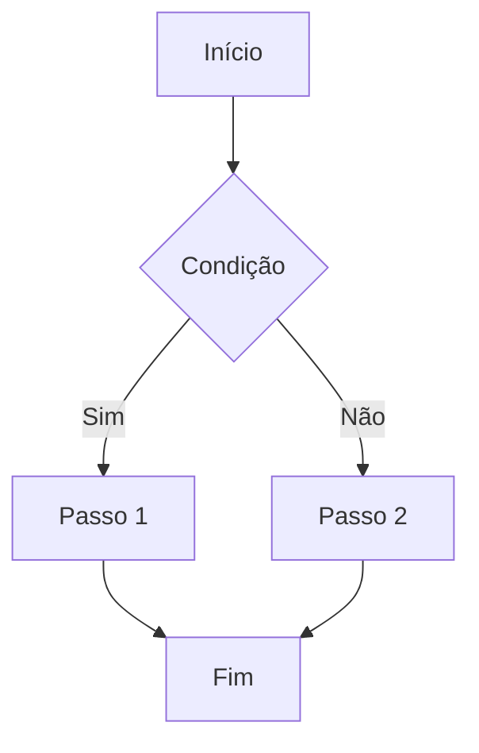

# fluxos-e-jornadas.md

> **Base de Conhecimento — Desenvolvimento**
> Centraliza fluxos de usuário, jornadas, fluxos de produto e fluxos de processo. Os agentes consultam este arquivo para entender como usuários e sistemas se movem pelo produto antes de sugerir soluções, novos requisitos ou alterações. Qualquer membro do time pode e deve mantê-lo atualizado.

---

## Metadados

| Campo | Valor |
|---|---|
| Cliente | [nome do cliente] |
| Time responsável | [nome do time/projeto] |
| Última atualização | [YYYY-MM-DD] |
| Atualizado por | [nome] |

---

## Tipos de fluxo

| Tipo | Descrição |
|---|---|
| **Jornada de usuário** | Experiência completa de um perfil ao longo do tempo — inclui emoções, pontos de contato e contexto fora do produto |
| **Fluxo de tela** | Sequência de telas e interações dentro do produto — foco na navegação e nas decisões do usuário |
| **Fluxo de processo** | Sequência de etapas de um processo de negócio — pode envolver múltiplos sistemas, áreas ou pessoas |
| **Fluxo de produto** | Comportamento interno do produto em resposta a ações ou eventos — foco na lógica e nos estados do sistema |

---

## Status possíveis

| Status | Significado |
|---|---|
| **Ativo** | Fluxo vigente, representa como o produto funciona hoje |
| **Proposto** | Fluxo desejado ou em discussão, ainda não implementado |
| **Revisado** | Substituído por uma versão mais recente. Mantido para rastreabilidade |
| **Descontinuado** | Fluxo que não existe mais no produto |

---

## Representação dos fluxos

Cada fluxo pode ser representado de três formas — use a que melhor se encaixa no contexto:

**1. Diagrama Mermaid embutido**
Para fluxos criados ou formalizados dentro do harness. Renderiza automaticamente no GitHub.

~~~markdown

~~~

**2. Referência a arquivo no repositório**
Para diagramas exportados ou imagens salvas na pasta `/diagramas` do repositório.
```markdown
**Diagrama:** 
```

**3. Referência a ferramenta externa**
Para diagramas que vivem no Figma, Miro ou outra ferramenta.
```markdown
**Diagrama:** [Ver no Figma](https://figma.com/...) — atualizado em AAAA-MM-DD
```

> Um fluxo pode ter mais de uma representação — por exemplo, um Mermaid para leitura rápida no repositório e um link para o Figma com o detalhamento visual completo.

---

## Índice

| ID | Título | Tipo | Produto | Status | Representação | Data |
|---|---|---|---|---|---|---|
| [FLX001] | [Título curto do fluxo] | [Fluxo de processo] | [P1] | [Ativo] | [Mermaid] | [YYYY-MM-DD] |

---

## Como registrar um fluxo

```
### [ID] — [Título curto do fluxo]

- **Data:** AAAA-MM-DD
- **Status:** Ativo | Proposto | Revisado | Descontinuado
- **Tipo:** Jornada de usuário | Fluxo de tela | Fluxo de processo | Fluxo de produto
- **Produto:** P1, P2 | Todos
- **Perfil envolvido:** [quem executa ou experiencia esse fluxo]
- **Decisões relacionadas:** [IDs — ex: D001, D003]
- **US relacionadas:** [IDs — ex: US-012, US-015]
- **Substituído por:** [ID do fluxo substituto, se status for Revisado]

**Contexto**
[Por que esse fluxo existe? Qual necessidade ou processo ele atende?]

**Diagrama**
[Mermaid embutido, referência a arquivo ou link externo — ver seção "Representação dos fluxos"]

**Pré-condições**
[O que precisa ser verdade para esse fluxo começar.]

**Fluxo principal**
1. [Passo 1]
2. [Passo 2]
3. [Passo 3]

**Variações e exceções**
- [Nome]: [quando ocorre e como o fluxo se comporta.]

**Pós-condições**
[Estado do sistema ou do usuário ao final do fluxo.]

**Pontos de atenção**
[Fricções conhecidas, riscos ou aspectos sensíveis.]
```

---

## Fluxos ativos e propostos

> Ordenados por tipo e depois por data — mais recentes no topo dentro de cada tipo.

_[Nenhum fluxo registrado ainda.]_

---

## Fluxos revisados e descontinuados

> Mantidos para rastreabilidade. Os agentes não devem usá-los como referência ativa.

_[Nenhum fluxo registrado ainda.]_
